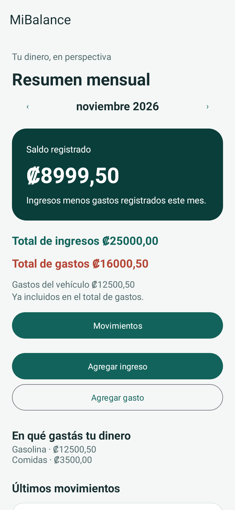
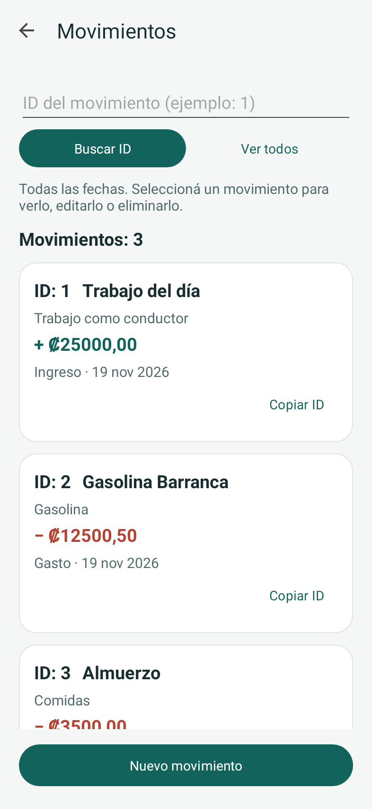
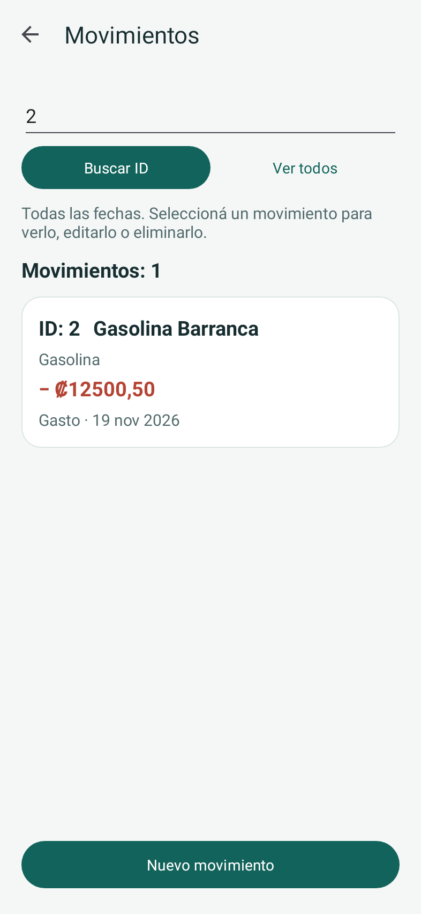
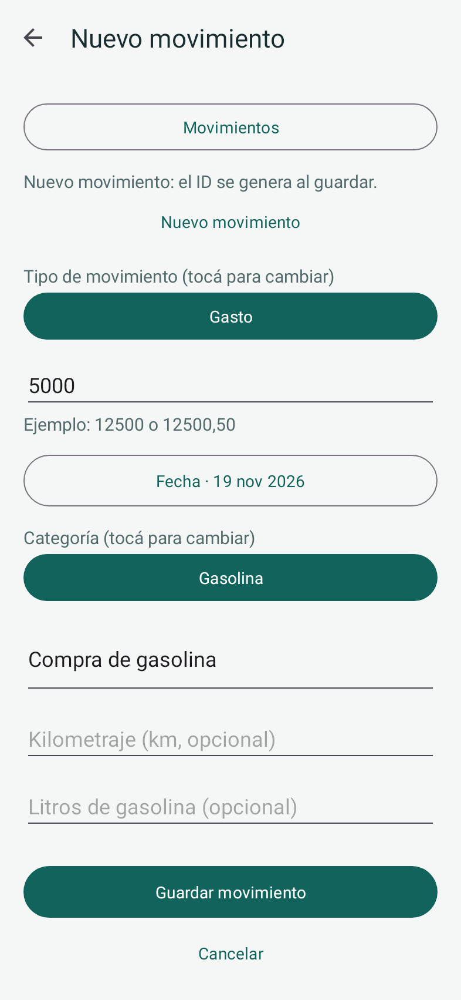
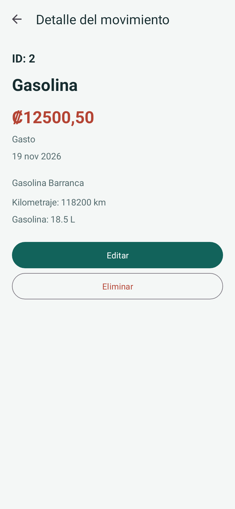
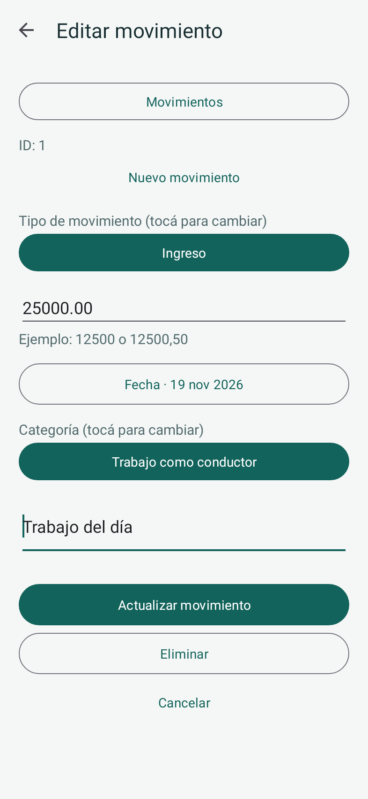
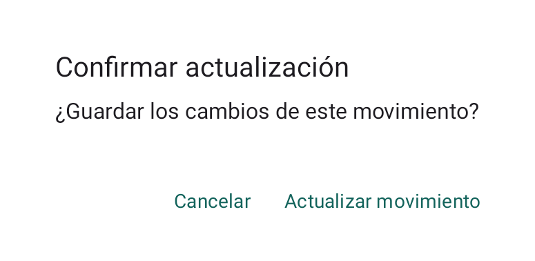
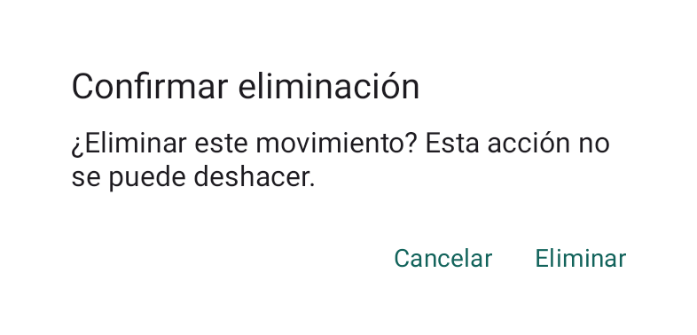

# MiBalance — Tarea 5

**Tu dinero, en perspectiva.** Mi aplicación Android para registrar ingresos, gastos personales y gastos del vehículo, y consultar el saldo de cada mes.

**Autor:** Mario Espinoza · **Curso:** ITI-623 · **Universidad:** UTN, Sede del Pacífico

**Rama:** `task5-MarioEspinoza-MiBalance` · **Entrega:** Tarea 5 — CRUD, búsqueda y confirmaciones

## Qué hice en esta tarea

Organicé el manejo de los ingresos y gastos alrededor de la pantalla **Movimientos**. Ahora puedo ver los registros antes de buscarlos, identificar cada uno por su número y nombre, y seleccionar el que quiero consultar, editar o eliminar.

- Agregué un botón **Movimientos** en el inicio y en el formulario.
- La lista muestra todos los movimientos registrados, de todas las fechas, ordenados por ID.
- Cambié los identificadores largos por números consecutivos: **1, 2, 3…**. Los ingresos y los gastos comparten la misma secuencia.
- Cada fila muestra **ID y nombre**, categoría, monto, tipo y fecha.
- Coloqué **Buscar ID** arriba de la lista. La búsqueda es exacta: buscar `1` muestra el movimiento 1, no el 10 ni el 11. **Ver todos** restaura la lista completa.
- Al seleccionar una fila puedo abrir su detalle y entrar a editar o eliminar.
- Al guardar un movimiento nuevo o una actualización, regreso a Movimientos.
- Agregué diálogos para confirmar o cancelar la actualización y la eliminación.
- El nombre o descripción es obligatorio. Conservé las validaciones de montos, kilometraje, litros y detalles de mantenimiento/reparación.
- Mantuve el código en inglés y los textos de la interfaz en español e inglés.

**Editar conserva el ID. Eliminar no cambia los IDs de los demás movimientos ni reutiliza el número eliminado.**

## Cómo se usa

1. En el inicio selecciono **Agregar ingreso** o **Agregar gasto**.
2. Completo el nombre, monto, fecha, categoría y los datos que correspondan. Presiono **Guardar movimiento**.
3. Se abre **Movimientos**, donde veo el registro con su ID numérico y nombre.
4. Selecciono una fila o escribo su ID en la búsqueda. Desde el detalle puedo **Editar** o **Eliminar**.
5. Si actualizo o elimino, confirmo la acción en el diálogo. Cancelar deja los datos guardados como estaban.

El botón **Nuevo movimiento** permite registrar otro ingreso o gasto. La búsqueda se limpia al volver después de guardar o de eliminar un movimiento buscado, para poder ver los registros restantes.

## Pantallas actuales de la Tarea 5

Las siguientes imágenes fueron **renderizadas externamente desde los layouts y el código actuales en un entorno Android API 28**, usando datos ficticios. El generador de imágenes no forma parte del código ni de las dependencias entregadas. Los formularios y la lista permiten desplazarse. Por separado, probé el flujo actualizado en mi teléfono HONOR y confirmé que funciona como esperaba.

| Resumen mensual | Movimientos: lista con ID y nombre |
| --- | --- |
|  |  |

| Búsqueda exacta por ID | Registrar un movimiento |
| --- | --- |
|  |  |

| Detalle del movimiento | Formulario de edición y acciones |
| --- | --- |
|  |  |

| Confirmar actualización | Confirmar eliminación |
| --- | --- |
|  |  |

### Diseños iniciales

Los diseños de las tareas anteriores se conservan como referencia. Incluyen propuestas como comprobantes y mapa que todavía no forman parte de la aplicación.

<details>
<summary>Ver los mockups iniciales</summary>


</details>

## Resumen mensual y categorías

Como conductor y estudiante necesito saber cuánto recibo, en qué lo gasto y cuánto me queda. Puedo cambiar el mes del resumen para consultar ingresos, gastos, gastos del vehículo y distribución por categoría. La pantalla Movimientos permite consultar todas las fechas.

**Saldo registrado = ingresos del mes − gastos del mes.** Los gastos del vehículo ya están incluidos en el total de gastos. MiBalance utiliza los datos que registro; no se conecta con cuentas bancarias ni con Uber.

| Ingresos | Gastos |
| --- | --- |
| Trabajo como conductor | Gasolina |
| Otros trabajos | Reparaciones del vehículo |
| Otros ingresos | Mantenimiento del vehículo |
| | Comidas |
| | Salidas y entretenimiento |
| | Servicios y gastos personales |
| | Otros gastos |

El kilometraje es opcional para gastos del vehículo y los litros son opcionales al registrar gasolina. En reparaciones y mantenimiento debo describir el trabajo realizado.

## Estructura y tecnologías

| Componente | Implementación |
| --- | --- |
| Inicio y resumen mensual | `DashboardActivity` / `activity_dashboard.xml` |
| Lista y búsqueda por ID | `HistoryActivity` / `activity_history.xml` |
| Crear y editar | `TransactionEditActivity` / `activity_transaction_edit.xml` |
| Detalle y eliminación | `DetailActivity` / `activity_detail.xml` |
| Filas del listado | `TransactionListAdapter` / `item_transaction.xml` |
| Modelos y reglas | `domain/model/Transaction.kt` |
| Interfaz de almacenamiento | `domain/repository/TransactionRepository.kt` |
| Datos e IDs consecutivos | `data/memory/MemoryDataRepository.kt` |
| Acceso compartido a los datos | `viewmodel/TransactionViewModel.kt` |
| Dinero, fechas, navegación y confirmaciones | `util/` |

Utilicé Kotlin, layouts XML, `findViewById`, `Intent`, `RecyclerView`, `DatePickerDialog` y `AlertDialog`, siguiendo el patrón del proyecto de clase. La aplicación conserva el repositorio en memoria. Los montos se calculan en centésimos con números enteros para conservar los decimales; el formulario admite coma o punto sin separadores de miles.

### Relación con lo visto en clase hasta semana 9

| Herramienta o patrón | Aplicación en MiBalance |
| --- | --- |
| Kotlin, modelos y enumeraciones | Movimientos, tipos, categorías y validaciones |
| Activities y layouts XML con `findViewById` | Inicio, Movimientos, detalle y formulario |
| `Intent` | Navegación y envío del ID seleccionado |
| `RecyclerView`, adaptador y listener | Lista y selección de movimientos |
| Interfaz de repositorio, memoria y ViewModel | Patrón trabajado antes de la integración de Room |
| `DatePickerDialog` y `AlertDialog` | Fecha y confirmaciones de actualización/eliminación |
| JUnit | Pruebas de montos, totales, búsqueda y operaciones del repositorio |

Tomé como referencia los ejemplos de [semana 7](https://github.com/utn-app-movil/task-mngr-g1/tree/semana7) y [semana 9](https://github.com/utn-app-movil/task-mngr-g1/tree/semana9). La numeración consecutiva y los cálculos son la lógica propia de mi proyecto, implementada con Kotlin. La entrega conserva estas herramientas sin agregar una biblioteca de pruebas de interfaz ni funciones de portapapeles.

### Almacenamiento de esta entrega

Los movimientos se comparten entre las pantallas mientras el proceso de la aplicación está activo. **Al finalizar el proceso, se borran los registros y la numeración vuelve a empezar en 1.** Esta versión todavía no utiliza Room ni almacenamiento permanente.

## Comprobación de los requisitos de Tarea 5

| Requisito del profesor | Lo que implementé |
| --- | --- |
| CRUD completo | Crear, consultar, actualizar y eliminar ingresos y gastos mediante lista, detalle y formulario |
| Diálogo al actualizar | Confirmar o cancelar antes de guardar cambios |
| Diálogo al eliminar | Confirmar o cancelar desde detalle o formulario |
| Búsqueda para editar | Buscar un ID, seleccionar el movimiento y abrir su edición |
| Código en inglés | Clases, funciones, variables e identificadores en inglés |
| Rama temporal, commits y push | Cambios publicados en `task5-MarioEspinoza-MiBalance` |
| PR hacia `main` con descripción y profesor como revisor | [PR #2](https://github.com/MarioEspinoza16/TareasAppsMoviles/pull/2), listo para revisión; revisión solicitada a `ebarahonautn` |

## Abrir y ejecutar

Desde PowerShell puedo descargar esta rama en una carpeta nueva:

```powershell
git clone --branch task5-MarioEspinoza-MiBalance --single-branch https://github.com/MarioEspinoza16/TareasAppsMoviles.git MiBalance-Tarea5
cd .\MiBalance-Tarea5
```

En Android Studio abro la carpeta que contiene `settings.gradle.kts`, sincronizo Gradle, selecciono el módulo `app` y mi dispositivo, y presiono **Run**.

El proyecto usa AGP 8.7.3, Gradle 8.9, Kotlin 2.0.21, JDK 17, SDK 35 y Build Tools 35.0.0. La versión mínima es Android 8.0/API 26. `local.properties` corresponde al SDK de cada computadora y no se comparte.

Para actualizar un clon existente, primero reviso `git status` y luego ejecuto `git pull --ff-only origin task5-MarioEspinoza-MiBalance` dentro de la rama de la tarea.

## Pruebas realizadas

- **11 pruebas de lógica con JUnit aprobadas**, la herramienta incluida también en el proyecto del profesor.
- Verifiqué IDs consecutivos, conservación de IDs al editar y eliminación sin reutilizarlos.
- Probé una lista con 50 movimientos de distintas fechas y la búsqueda exacta por ID.
- Probé el flujo de consulta, actualización, confirmación/cancelación y eliminación en mi HONOR.
- **Android Lint:** sin errores; conserva advertencias no bloqueantes.
- **Compilación del APK:** correcta.
- **Prueba en mi HONOR:** confirmé que el flujo actualizado funciona como quería.

```powershell
.\gradlew.bat testDebugUnitTest lintDebug assembleDebug
```

El APK de depuración se genera en `app/build/outputs/apk/debug/app-debug.apk`. Los resultados están en [VALIDATION.md](docs/VALIDATION.md) y el recorrido de prueba está en [MANUAL_TESTS.md](docs/MANUAL_TESTS.md).

## Entrega y revisión

Mi Pull Request es **[task5-MarioEspinoza-MiBalance — PR #2](https://github.com/MarioEspinoza16/TareasAppsMoviles/pull/2)**, con destino `main`. La rama incluye la Tarea 4 como base porque ese avance aún no está fusionado en `main`.

El PR ya está listo para revisión y solicité la revisión del profesor **ebarahonautn**. Debo entregar el enlace del PR en el campus y esperar su aprobación antes de hacer el merge.
