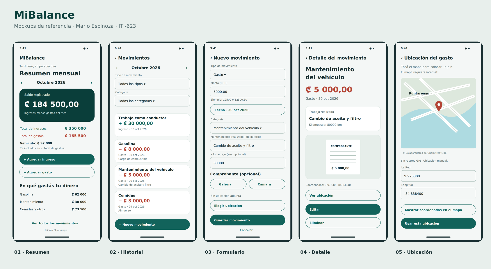

# MiBalance

**Tu dinero, en perspectiva.** Aplicación Android individual para registrar ingresos, gastos personales y gastos del vehículo, y consultar el saldo de cada mes.

**Autor:** Mario Espinoza · **Curso:** ITI-623 · UTN Sede del Pacífico
**Modalidad:** individual · **Repositorio:** TareasAppsMoviles
**Entrega actual:** Tarea 5 — CRUD, búsqueda y diálogos de confirmación.

## Problema que quiero resolver

Como conductor y estudiante necesito saber cuánto dinero recibo, en qué lo gasto y cuánto me queda cada mes. Quiero registrar gasolina, reparaciones y el mantenimiento específico del vehículo, además de comidas, salidas y otros gastos personales. MiBalance es independiente de Uber: no se conecta con cuentas, viajes ni APIs de esa plataforma.

## Alcance y funcionalidades

- Crear, consultar, editar y eliminar ingresos y gastos.
- Seleccionar fecha, monto en CRC, tipo, categoría y nombre/descripción obligatoria.
- Describir obligatoriamente el mantenimiento o la reparación realizada.
- Registrar kilometraje opcional en gastos del vehículo y litros opcionales al cargar gasolina.
- Cambiar el mes del resumen; la pantalla Movimientos siempre permite consultar todas las fechas.
- Consultar ingresos, gastos, saldo y distribución de gastos por categoría.
- Mostrar IDs consecutivos (1, 2, 3…) junto al nombre de cada movimiento, con botón Copiar ID.
- Abrir Movimientos desde el inicio o el formulario; ver todos los registros de todas las fechas y buscar un ID exacto.
- Al guardar, regresar a Movimientos. Seleccionar una fila para consultar, editar o eliminar el movimiento.
- Confirmar la actualización y la eliminación mediante diálogos con opciones de confirmar o cancelar.
- Crear, consultar, actualizar y eliminar desde `TransactionEditActivity`.
- Mostrar los textos en español o inglés según el idioma del dispositivo.
- Mantener los movimientos en memoria durante la sesión de la aplicación.

**Saldo registrado = ingresos del mes − gastos del mes.** Los gastos del vehículo ya están incluidos en el total de gastos. El saldo representa los movimientos ingresados, no un saldo bancario conectado.

| Ingresos | Gastos |
| --- | --- |
| Trabajo como conductor | Gasolina |
| Otros trabajos | Reparaciones del vehículo |
| Otros ingresos | Mantenimiento del vehículo |
| | Comidas |
| | Salidas y entretenimiento |
| | Servicios y gastos personales |
| | Otros gastos |

## Mockups y pantallas

Los mockups conservan el diseño inicial con datos ficticios. Las imágenes todavía muestran funciones propuestas como comprobantes y mapa. La aplicación implementa cuatro pantallas XML; la Tarea 5 incorpora Movimientos con búsqueda por ID, detalle y formulario de edición.



| Pantalla | Mockup | Activity y layout |
| --- | --- | --- |
| Resumen mensual | [Diseño](docs/mockups/01-dashboard.png) | `DashboardActivity` / `activity_dashboard.xml` |
| Movimientos con búsqueda por ID | [Diseño](docs/mockups/02-history.png) | `HistoryActivity` / `activity_history.xml` |
| Crear o editar movimiento | [Diseño](docs/mockups/03-editor.png) | `TransactionEditActivity` / `activity_transaction_edit.xml` |
| Detalle y acciones | [Diseño](docs/mockups/04-detail.png) | `DetailActivity` / `activity_detail.xml` |
| Ubicación del gasto (propuesta futura) | [Diseño](docs/mockups/05-location.png) | Pendiente |

Los formularios son desplazables. El monto tiene ejemplos y validación; los campos del vehículo aparecen según la categoría. Ingresos y gastos se distinguen mediante texto, signo y color. Se muestran estados sin datos, validaciones y confirmación de eliminación. Los controles respetan las barras del sistema y el teclado.

## Estructura del proyecto

```text
app/src/main/java/com/marioespinoza/mibalance/
├── domain/
│   ├── model/Transaction.kt
│   └── repository/TransactionRepository.kt
├── data/memory/MemoryDataRepository.kt
├── viewmodel/TransactionViewModel.kt
├── ui/ (cuatro Activities y TransactionListAdapter)
└── util/ (dinero, fechas, navegación y etiquetas)
```

La base del proyecto sigue el patrón en memoria de [semana7 de TaskManager](https://github.com/utn-app-movil/task-mngr-g1/tree/semana7). Para Tarea 5 agregué búsqueda y diálogos `AlertDialog`, también utilizados en el ejemplo de clase de semana 9. La captura del enunciado recibida solicita CRUD, búsqueda y confirmaciones; esta entrega conserva el repositorio en memoria. Las Activities usan `setContentView`, `findViewById` y `Intent`. El historial usa un `RecyclerView` con adaptador y listener. El ViewModel comparte una instancia del repositorio en memoria, como `TaskViewModel` con `TaskMemoryManager` en el ejemplo de clase.

Los montos se calculan con números enteros en centésimos para conservar los decimales. El formulario admite coma o punto sin separadores de miles. La fecha se elige con `DatePickerDialog`.

## Requisitos de las tareas

| Tarea | Requisito | Implementación |
| --- | --- | --- |
| 2 | Definición individual y descripción | Este README |
| 2 | Mockups y UX | `docs/mockups/` y tabla de pantallas |
| 2 | CRUD, filtros, cámara/galería, diálogos, mapa | CRUD, búsqueda por ID, resumen mensual y selector de fecha implementados. Cámara, galería y mapa quedan como propuesta para más adelante. |
| 3 | Modelos y clases generales | `domain/model/`, `util/` |
| 3 | Interfaz de repositorio | `domain/repository/` |
| 3 | MemoryDataRepository | `data/memory/` |
| 3 | ViewModels | `viewmodel/` |
| 3 y 4 | Código en inglés | Identificadores y comentarios en inglés |
| 3 y 4 | Recursos en dos idiomas | `res/values/strings.xml` y `res/values-es/strings.xml` |
| 4 | Activities y layouts según mockups | Cuatro Activities y cuatro layouts XML |
| 5 | CRUD completo | Movimientos permite buscar y seleccionar; detalle y formulario permiten consultar, actualizar y eliminar con confirmación |
| 5 | Diálogos al actualizar y eliminar | `confirmAction` con confirmar/cancelar; eliminación también desde detalle |
| 5 | Búsqueda para entrar en modo edición | ID numérico exacto en Movimientos, lista con ID y nombre, acceso al detalle y edición |
| 5 | Código en inglés | Clases, funciones, variables, recursos e identificadores en inglés; traducciones de interfaz separadas |
| 5 | Rama temporal y PR hacia main | `task5-MarioEspinoza-MiBalance`; aprobación del profesor antes de merge |

## Abrir y ejecutar en Android Studio

1. Clonar el repositorio o extraer el proyecto y abrir la carpeta que contiene `settings.gradle.kts`.
2. Usar una versión de Android Studio compatible con AGP 8.7.3 (Ladybug o posterior). Configurar **Gradle JDK 17** en los ajustes de Gradle; no editar versiones automáticamente si ya sincroniza.
3. Instalar Android SDK Platform 35 y Build Tools 35.0.0 desde SDK Manager si se solicitan.
4. Esperar la sincronización con acceso a internet. Gradle Wrapper utiliza Gradle 8.9; Kotlin 2.0.21.
5. Ejecutar la configuración `app` en un dispositivo o emulador Android 8.0/API 26 o superior.

Android Studio crea `local.properties` para el SDK de cada computadora; ese archivo no se comparte.

En Windows, desde PowerShell en la raíz:

```powershell
.\gradlew.bat testDebugUnitTest lintDebug assembleDebug
```

El APK se genera en `app/build/outputs/apk/debug/app-debug.apk`. Es una compilación de prueba, no una publicación en Play Store.

## Prueba en mi celular HONOR

Consultar [la guía de instalación y entrega](docs/INSTALL_AND_DELIVERY.md). La compatibilidad mínima del proyecto es Android 8.0; MagicOS por sí solo no identifica la versión de Android. Confirmar esa versión en Ajustes → Acerca del teléfono.

## Datos en memoria

Los movimientos se comparten entre las pantallas mientras el proceso de MiBalance sigue activo. Al finalizar el proceso, la lista vuelve a estar vacía. En el formulario, tocá el botón de tipo o categoría para recorrer las opciones. Los IDs se asignan al guardar y comparten una secuencia para ingresos y gastos. Editar conserva el ID; eliminar no renumera los demás ni reutiliza ese número. Como el almacenamiento sigue siendo en memoria, al terminar el proceso se borran los registros y el contador vuelve a empezar en 1.

## Verificación

Ver [VALIDATION.md](docs/VALIDATION.md) para los resultados de esta versión y [MANUAL_TESTS.md](docs/MANUAL_TESTS.md) para el recorrido de prueba.

## Entrega y revisión

La rama de trabajo y el título del PR son **`task5-MarioEspinoza-MiBalance`**, con destino `main`. La rama incluye el código de la Tarea 4 como base porque ese avance aún no está fusionado en `main`.

Debo agregar al profesor **ebarahonautn** como revisor, entregar la URL del PR en el campus y esperar su aprobación antes de hacer merge. La descripción está preparada en [PR_DESCRIPTION.md](docs/PR_DESCRIPTION.md).

## Créditos técnicos

- [Android Developers](https://developer.android.com/) — plataforma, AndroidX y herramientas.
- [Material Components for Android](https://github.com/material-components/material-components-android) — componentes de interfaz.
