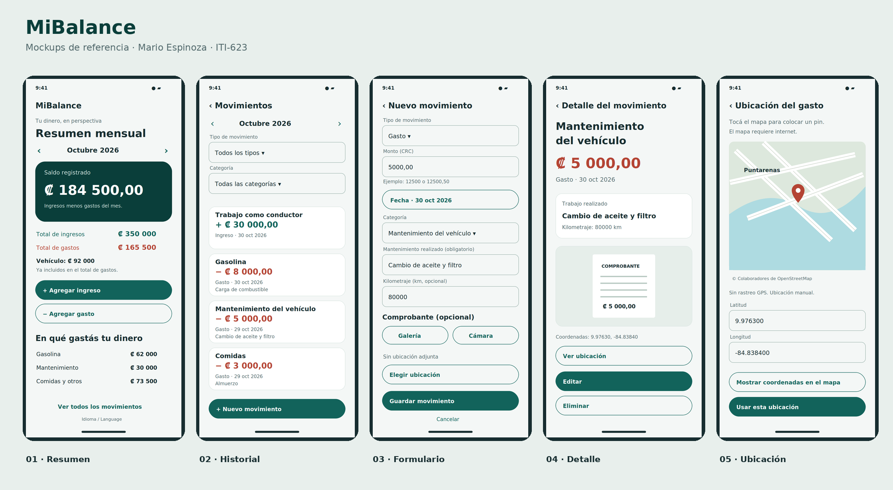

# MiBalance

**Tu dinero, en perspectiva.** Aplicación Android individual para registrar ingresos, gastos personales y gastos del vehículo, y consultar el saldo de cada mes.

**Autor:** Mario Espinoza · **Curso:** ITI-623 · UTN Sede del Pacífico
**Modalidad:** individual · **Repositorio:** TareasAppsMoviles
**Entrega actual:** Tarea 4 — Layout design and activities creation.

## Problema que quiero resolver

Como conductor y estudiante necesito saber cuánto dinero recibo, en qué lo gasto y cuánto me queda cada mes. Quiero registrar gasolina, reparaciones y el mantenimiento específico del vehículo, además de comidas, salidas y otros gastos personales. MiBalance es independiente de Uber: no se conecta con cuentas, viajes ni APIs de esa plataforma.

## Alcance y funcionalidades

- Crear, consultar, editar y eliminar ingresos y gastos.
- Seleccionar fecha, monto en CRC, tipo, categoría y descripción.
- Describir obligatoriamente el mantenimiento o la reparación realizada.
- Registrar kilometraje opcional en gastos del vehículo y litros opcionales al cargar gasolina.
- Adjuntar comprobantes desde la cámara o galería.
- Seleccionar una ubicación opcional para un gasto en un mapa OpenStreetMap o mediante coordenadas.
- Filtrar el historial por mes, año, tipo y categoría.
- Consultar ingresos, gastos, saldo y distribución de gastos por categoría.
- Confirmar eliminaciones y el abandono del formulario mediante diálogos.
- Cambiar entre español e inglés desde el resumen.
- Conservar los movimientos y las fotos localmente al cerrar la aplicación.

**Saldo registrado = ingresos del mes − gastos del mes.** Los gastos del vehículo ya están incluidos en el total de gastos. El saldo representa los movimientos ingresados, no un saldo bancario conectado.

| Ingresos | Gastos |
| --- | --- |
| Trabajo como conductor | Gasolina |
| Otros trabajos | Reparaciones del vehículo |
| Otros ingresos | Mantenimiento del vehículo |
| | Comidas |
| | Salidas y entretenimiento |
| | Servicios y gastos personales |
| | Otros gastos |

## Mockups y pantallas

Los mockups son diseños de referencia con datos ficticios, no capturas de una ejecución en el teléfono. Representan las mismas cinco pantallas implementadas en XML.



| Pantalla | Mockup | Activity y layout |
| --- | --- | --- |
| Resumen mensual | [Diseño](docs/mockups/01-dashboard.png) | `DashboardActivity` / `activity_dashboard.xml` |
| Historial con filtros | [Diseño](docs/mockups/02-history.png) | `HistoryActivity` / `activity_history.xml` |
| Crear o editar movimiento | [Diseño](docs/mockups/03-editor.png) | `TransactionEditActivity` / `activity_transaction_edit.xml` |
| Detalle y acciones | [Diseño](docs/mockups/04-detail.png) | `DetailActivity` / `activity_detail.xml` |
| Ubicación del gasto | [Diseño](docs/mockups/05-location.png) | `LocationActivity` / `activity_location.xml` |

Los formularios son desplazables. El monto tiene ejemplos y validación; los campos del vehículo aparecen según la categoría. Ingresos y gastos se distinguen mediante texto, signo y color. Se muestran estados sin datos, errores de carga y confirmaciones. Los controles respetan las barras del sistema y el teclado.

## Estructura del proyecto

```text
app/src/main/java/com/marioespinoza/mibalance/
├── BalanceApplication.kt
├── domain/
│   ├── model/Transaction.kt
│   └── repository/TransactionRepository.kt
├── data/
│   ├── memory/MemoryDataRepository.kt
│   └── local/LocalTransactionRepository.kt
├── viewmodel/TransactionViewModels.kt
├── ui/  (cinco Activities y BaseActivity)
└── util/ (dinero, comprobantes y etiquetas)
```

La interfaz de repositorio desacopla las pantallas del almacenamiento. Cada pantalla dispone de un ViewModel. Las consultas se ejecutan fuera del hilo principal con coroutines y se observan mediante LiveData.

`MemoryDataRepository` cumple el requisito académico de la tarea 3 y se utiliza en pruebas. Sus datos son temporales. La aplicación real usa `LocalTransactionRepository`, implementado con SQLiteOpenHelper, para conservar los registros. Se eligió SQLite directo por su alcance pequeño y para evitar generación de código adicional; Room queda como una posible mejora futura, no es una dependencia actual.

Los montos se almacenan como `Long` en centésimos y se procesan con `BigDecimal`; no se usa `Double` para dinero. Las fechas se almacenan en formato ISO y se muestran según el idioma. Se admite coma o punto como separador decimal, sin separadores de miles al ingresar valores.

## Requisitos de las tareas

| Tarea | Requisito | Implementación |
| --- | --- | --- |
| 2 | Definición individual y descripción | Este README |
| 2 | Mockups y UX | `docs/mockups/` y tabla de pantallas |
| 2 | CRUD, filtros, cámara/galería, diálogos, mapa | Activities y repositorios |
| 3 | Modelos y clases generales | `domain/model/`, `util/` |
| 3 | Interfaz de repositorio | `domain/repository/` |
| 3 | MemoryDataRepository | `data/memory/` |
| 3 | ViewModels | `viewmodel/` |
| 3 y 4 | Código en inglés | Identificadores y comentarios en inglés |
| 3 y 4 | Recursos en dos idiomas | `res/values/strings.xml` y `res/values-es/strings.xml` |
| 4 | Activities y layouts según mockups | Cinco Activities y cinco layouts XML |
| 2–4 | Acceso del profesor, protección de main, PR y revisión | Configuración remota pendiente de verificar; ver guía de entrega |

## Abrir y ejecutar en Android Studio

1. Clonar el repositorio o extraer el proyecto y abrir la carpeta que contiene `settings.gradle.kts`.
2. Usar una versión de Android Studio compatible con AGP 8.7.3 (Ladybug o posterior). Configurar **Gradle JDK 17** en los ajustes de Gradle; no editar versiones automáticamente si ya sincroniza.
3. Instalar Android SDK Platform 35 y Build Tools 35.0.0 desde SDK Manager si se solicitan.
4. Esperar la sincronización con acceso a internet. Gradle Wrapper utiliza Gradle 8.9; Kotlin 2.0.21.
5. Ejecutar la configuración `app` en un dispositivo o emulador Android 8.0/API 26 o superior.

No es necesario configurar servidor, cuenta, contraseña, API de Uber ni clave de Google Maps. Android Studio crea `local.properties` para el SDK de cada computadora; ese archivo no se comparte.

En Windows, desde PowerShell en la raíz:

```powershell
.\gradlew.bat testDebugUnitTest lintDebug assembleDebug
```

El APK se genera en `app/build/outputs/apk/debug/app-debug.apk`. Es una compilación de prueba, no una publicación en Play Store.

## Prueba en mi celular HONOR

Consultar [la guía de instalación y entrega](docs/INSTALL_AND_DELIVERY.md). La compatibilidad mínima del proyecto es Android 8.0; MagicOS por sí solo no identifica la versión de Android. Confirmar esa versión en Ajustes → Acerca del teléfono.

## Privacidad y límites

- Sin login, publicidad, analítica, conexión bancaria ni rastreo GPS.
- Movimientos y comprobantes quedan en el almacenamiento privado de la aplicación. Al desinstalarla o borrar sus datos se pierden; esta versión no tiene exportación ni copia de seguridad y no cifra adicionalmente la base de datos.
- Cámara y galería usan aplicaciones del sistema y selección explícita del usuario; no se solicitan permisos amplios de archivos.
- El mapa descarga mosaicos de OpenStreetMap mediante osmdroid. Requiere internet para zonas no almacenadas; se pueden introducir coordenadas sin conexión. El proveedor del mapa recibe las solicitudes habituales de red de los mosaicos. No se envían importes, notas ni comprobantes al mapa.
- No se carga información ficticia automáticamente en la aplicación.
- Las pruebas automatizadas no sustituyen la comprobación física de cámara, galería, teclado y navegación en el HONOR.

## Verificación

Ver [VALIDATION.md](docs/VALIDATION.md) para los resultados de esta versión y [MANUAL_TESTS.md](docs/MANUAL_TESTS.md) para el recorrido de prueba.

## Entrega y revisión

La rama de trabajo es `task4-MiBalance-MarioEspinoza`. El título del PR debe ser **task4-MiBalance-MarioEspinoza** y su destino `main`. Se debe solicitar revisión a **ebarahonautn**, entregar la URL del PR en el campus y esperar la aprobación antes del merge.

Las bases de las tareas 2 y 3 se incluyen como trabajo realizado ahora para dar continuidad a la tarea 4; no se presentan como entregas anteriores. La captura de la tarea 3 utiliza el prefijo `task2-` para el PR, aunque su encabezado dice tarea 3; conviene confirmar esa inconsistencia si se solicita una entrega independiente.

## Créditos técnicos

- [Android Developers](https://developer.android.com/) — plataforma, AndroidX y herramientas.
- [Material Components for Android](https://github.com/material-components/material-components-android) — componentes de interfaz.
- [osmdroid](https://github.com/osmdroid/osmdroid) — visor de mapas, Apache-2.0.
- [OpenStreetMap](https://www.openstreetmap.org/copyright) — datos cartográficos y atribución. Uso de mosaicos según su [política](https://operations.osmfoundation.org/policies/tiles/).
